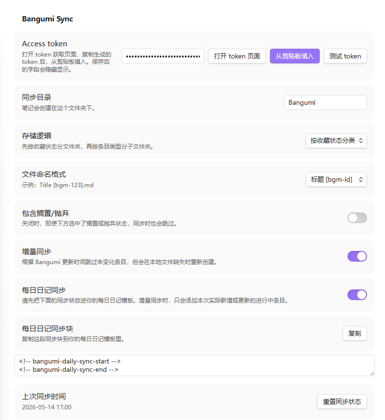
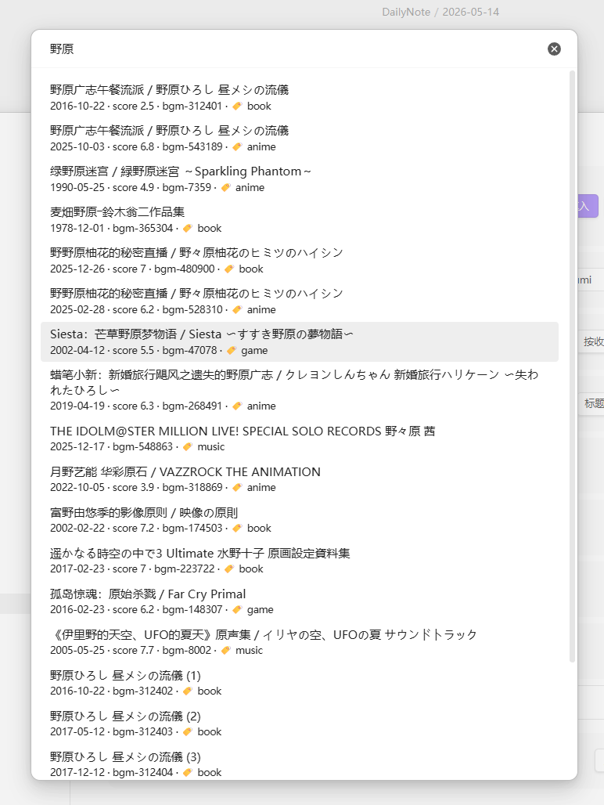
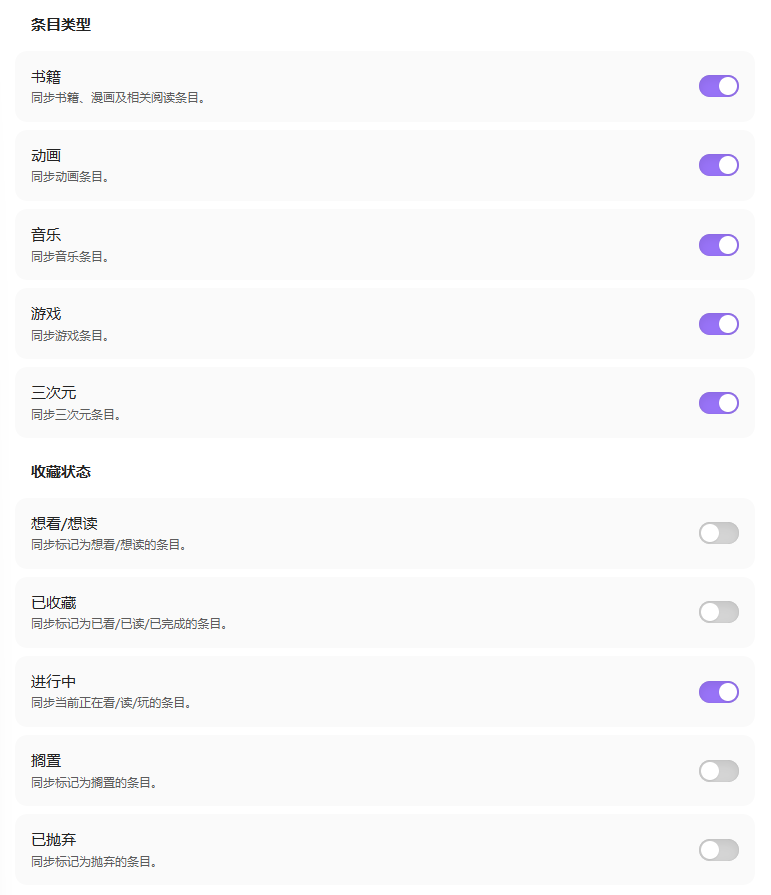
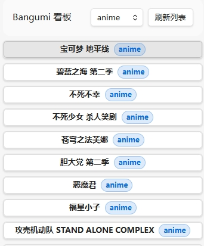
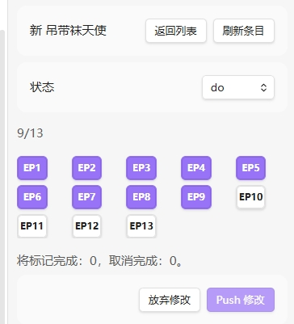
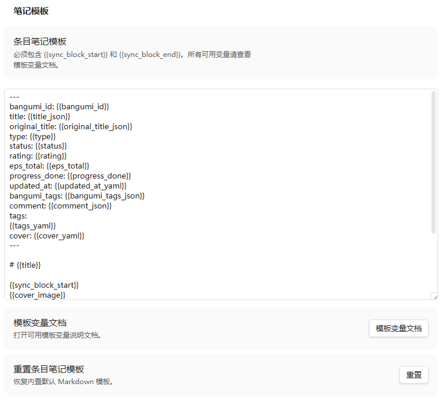
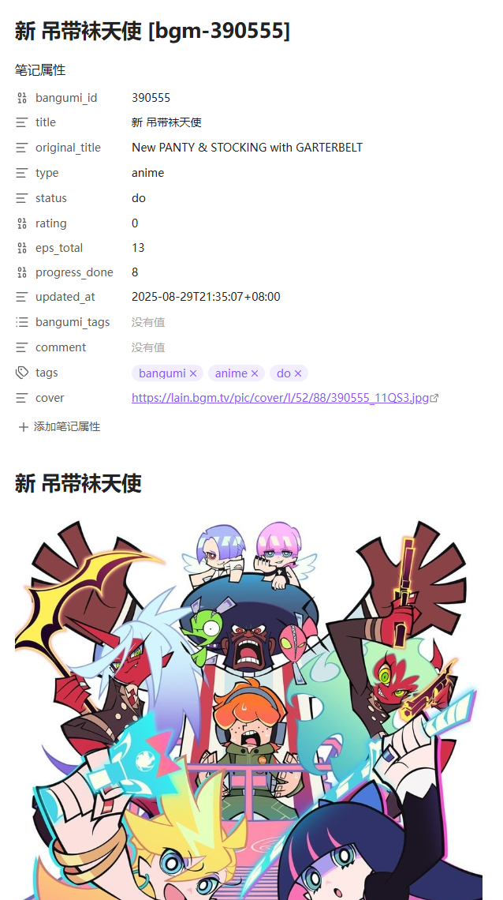
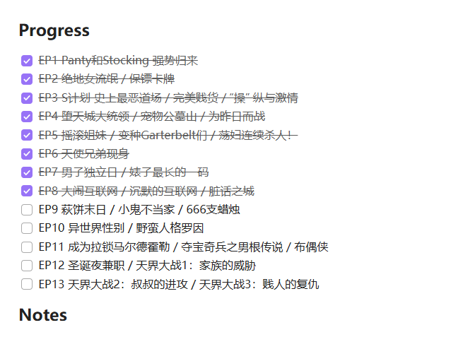
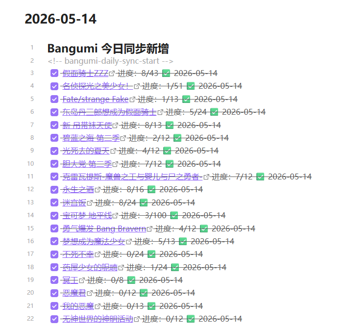

# Bangumi Sync

[English](#english) | [中文](#中文)

---

## English

### One-line Introduction

Bangumi Sync is an Obsidian plugin for turning Bangumi collections into local notes. It supports multiple subject types, collection-status filters, episode progress, incremental sync, Daily Note sync blocks, and user-editable templates.

### Features

- Sync Bangumi books, anime, music, games, and real-life media.
- Collection-status filtering: sync wish, collected, doing, on-hold, and dropped subjects.
- Incremental sync: automatically recreate local subject notes if they were deleted.
- Custom sync: sync rating, tags, comment, cover, episode checklist, and other optional fields; customize subject note templates and frontmatter fields. See the template variable documentation for details.
- Section-based note sync: use sync blocks so you can freely write elsewhere in the same file.
- Daily Note sync: optionally write newly added or updated in-progress subjects to a Daily Note sync block.
- On Air note: optionally generate a standalone On Air note with both the full broadcast list and your wished/watching anime list.
- Single-subject sync: search and sync one subject by Bangumi URL, ID, Chinese title, original title, or title keyword.
- Progress board: review `status: do` subjects in one board and safely push episode progress from a grid UI.
- Write back to Bangumi: explicitly push the current subject note's episode progress and status back to Bangumi, with remote verification after write-back.
- Issue review: generate `Bangumi Sync Report.md` when sync issues occur.
- Network resilience: built-in DNS-over-HTTPS fallback. When the system DNS returns wrong bgm.tv addresses and syncing fails with network errors, the plugin can resolve through DoH instead. It keeps the normal network path first by default, so users behind a proxy or with a healthy DNS are unaffected, and it can be turned off.

Screenshots are shared by both languages and listed at the bottom: [Screenshots](#screenshots).

### Installation

#### Obsidian Community Plugins

1. Open Obsidian settings.
2. Go to `Community plugins` and make sure restricted mode is off.
3. Click `Browse` and search for `bangumi`.
4. Install and enable the plugin.

#### Manual Installation

1. Download `manifest.json`, `main.js`, and `styles.css` from a release.
2. Create `.obsidian/plugins/bangumi-note/` in your vault.
3. Put those three files into that folder.
4. Restart Obsidian or reload community plugins.
5. Enable `bangumi` in Settings → Community plugins.

#### BRAT

If you use [BRAT](https://github.com/TfTHacker/obsidian42-brat) to install beta/development plugins:

1. Install and enable BRAT in Obsidian.
2. Open the command palette and run `BRAT: Add a beta plugin for testing`.
3. Enter this repository, for example `kuanphough/obsidian-bangumi`, or the full GitHub URL.
4. After BRAT downloads the plugin, enable `bangumi` in Community plugins.

BRAT is intended for testing development builds. After a stable release is available, most users should prefer Obsidian Community plugins or GitHub release attachments.

### Getting Started

1. Open plugin settings and click `Open token page`.
2. Log in to Bangumi, create an access token, and copy it.
3. Return to Obsidian and click `Fill from clipboard`, or paste it into `Access token`.
4. Click `Test token` to verify the configuration.
5. Choose sync directory, storage layout, file name format, subject types, and collection statuses.
6. Click the ribbon icon or run `Bangumi Sync: Sync now`.
7. To sync one subject, run `Bangumi Sync: Sync one subject` or click `Sync one subject` in settings.

The plugin automatically syncs the Bangumi account that owns the saved token. Username is not required. `User-Agent` is generated from the plugin version.

### Access Token

Token page: <https://next.bgm.tv/demo/access-token/create>

Keep the token private. It authorizes the plugin to read your Bangumi account data. The token input is displayed as a password field.

### Settings

| Setting | Description |
| --- | --- |
| `Access token` | Bangumi access token. Paste manually or fill from clipboard. |
| `Sync directory` | Root folder for synced notes. Default: `Bangumi`. |
| `Storage layout` | Store notes flat, by subject type, or by collection status. |
| `Folder naming` | Whether classification folders use English codes (`anime`/`do`) or Chinese (动画/在看). Note frontmatter always keeps the English codes, so switching never rewrites existing notes. Chinese follows Bangumi's per-type wording: books use 想读/读过/在读, music uses 想听/听过/在听, everything else uses 想看/看过/在看. |
| `Migrate classification folders` | Move existing notes from the previous folder naming to the current one. A preview is shown first and notes whose target path already exists are skipped; only available when the storage layout is not flat. |
| `File name format` | How note file names are built from the subject title and the Bangumi subject id. Three formats are available. |
| `Include on hold/dropped` | Whether to sync on-hold and dropped subjects. |
| `Incremental sync` | Skip unchanged subjects by Bangumi updated time and recreate missing local notes. |
| `DNS fix (DoH)` | How `api.bgm.tv` is resolved. `Auto` (default) uses the normal network path first and only switches to DNS-over-HTTPS after a network failure; `Always` resolves through DoH up front; `Off` keeps Obsidian's default transport. Useful when the system DNS returns wrong bgm.tv addresses and syncing fails with network errors. Desktop only. |
| `Localize cover images` | Download covers into the vault and link them locally instead of the remote URL. Applies to every note already in the sync directory, regardless of the selected subject types and statuses. Off by default because it stores extra files; enable it when remote covers do not load (for example when the system DNS cannot resolve `lain.bgm.tv`). Images go to a `covers` folder inside the sync directory. |
| `Cover folder` | Vault folder that receives localized covers. Empty means a `covers` folder inside the sync directory. Point it at an existing attachment folder if that is where your images live. Already downloaded covers are not moved when this changes. |
| `Daily note sync` | Write newly added or updated in-progress subjects to today's Daily Note block. |
| `Daily note folder` | Folder that holds your daily notes. Leave empty to use the Daily Notes core plugin setting; fill it in when you create daily notes with QuickAdd, Periodic Notes, or another method. |
| `Daily note date format` | Moment.js date format for the daily note file name. Leave empty to use the core plugin setting, falling back to `YYYY-MM-DD`. |
| `Enable On Air note` | Generate `Bangumi/On Air.md` after sync, grouped by weekday for all broadcasts and your wished/watching anime. |
| `Enable write-back to Bangumi` | Allow manual Push from the current subject note for episode checklist changes and collection status, and allow board status write-back. Disabled by default; every Push requires confirmation. |
| `Subject note template` | Customize the Markdown template for subject notes. |

### Sync One Subject

Run `Bangumi Sync: Sync one subject`, or click `Sync one subject` in settings. The command opens a search picker where you can enter:

- A Bangumi subject URL, for example `https://bgm.tv/subject/543189`
- A Bangumi subject ID, for example `543189`
- A Chinese title, original title, or title keyword

URLs and IDs show a direct sync option. Keywords search books, anime, music, games, and real-life subjects. Search results include year, score, `bgm-id`, and a subject type tag.

If the subject is already in your Bangumi collection, the plugin uses the real collection status, rating, tags, and comment. If it is not collected, the plugin asks you to choose a status, creates the Bangumi collection first, then generates the local note. The new collection writes only the status; rating, tags, and comment are not filled automatically.

### Bangumi Board

Run `Bangumi Sync: Open Bangumi board`, or click the board ribbon icon, to open the in-progress board.

The board only scans Bangumi notes under the sync directory, and only lists notes whose frontmatter has `status: do`. The type filter defaults to `anime`, and can be switched to all types, books, music, games, or real-life subjects. The list only shows the subject title and a type badge. Opening the list does not fetch episode progress for every subject; episode progress is loaded only after you select an item.

In the grid UI, clicking an episode only changes the local preview. The plugin writes to Bangumi only after you click `Push changes` and confirm. After remote verification succeeds, the local Markdown checklist and `progress_done` are updated too. The grid includes main episodes, SP, OP, ED, PV, MAD, and Other. Main episodes are sorted first; non-main episode types are visually marked.

You can also change the collection status from the board. Every status change opens a comment and rating input and shows a diff preview for status, rating, and comment. After confirmation, the new status, comment, and rating are written to Bangumi. After a successful status change, the local note is re-rendered so status, comment, and rating in frontmatter and the sync block are updated; classified notes are also moved to the matching status folder.

### Write Back to Bangumi

Write-back is disabled by default. After enabling `Enable write-back to Bangumi`, open a Bangumi subject note and run `Bangumi Sync: Push current note to Bangumi`.

The first version is intentionally narrow:

- It only handles the currently open subject note. There is no batch write-back.
- It can write `status` values `wish`, `do`, `collect`, `on_hold`, and `dropped`.
- Episode checklist changes are only written for `do` / `collect` subjects.
- Current-note Push writes `status`, `rating`, `comment`, and episode checklist changes from frontmatter. Tags, text outside the sync block, and Daily Note content are not written back yet.
- After writing, it reads Bangumi again to verify that episode progress and status actually changed. If the remote data does not confirm the write, the plugin reports failure instead of treating it as success.
- The plugin can write Bangumi progress, but it cannot control Bangumi timeline text or timeline merge rules. When progress records are close in time, Bangumi may merge them into the latest activity.
- If storage layout is not flat, the current note is moved automatically according to the final remote status after a successful status write-back.

Older notes without `bgm-ep` episode markers must be synced once before they can be pushed.

### On Air Note

After enabling `Enable On Air note`, every `Sync now` run updates the standalone `Bangumi/On Air.md` note. You can also run `Bangumi Sync: Update On Air note` to refresh it manually.

The first version uses Bangumi's legacy `/calendar` weekly anime broadcast data. The note has two sections: `My Collections` only shows your `wish` and `do` anime collections; `All On Air` shows the full Bangumi calendar list. Both sections are grouped from Monday to Sunday.

Rows in the collection section use a plain task-list format. Episode progress is no longer fetched per subject, which keeps refreshes much faster:

```markdown
- [ ] [[Local subject note|Title]] · status: do
```

If a matching local subject note exists, the title links to that note. Otherwise it links to the Bangumi subject page. Because `/calendar` is an anime broadcast calendar, books, music, games, and real-life subjects are not supported here yet.

### Sync Behavior

- The plugin only reads your configured sync directory, today's Daily Note when Daily Note sync is enabled, and the currently open note when you manually Push; it does not scan the whole vault for sync or board features.
- Repeat syncs update frontmatter and the block between `<!-- bangumi-sync-start -->` and `<!-- bangumi-sync-end -->`.
- Content outside the sync block is preserved, including `## Notes`.
- Full sync compares rendered content before writing, so unchanged files are not touched.
- To reduce API requests, episode progress is fetched by default only for `wish` / `do` / `collect` book, anime, and real-life subjects. Games, music, on-hold, and dropped subjects skip episode progress.
- Episode progress failures do not block note generation; reports show that progress content was not fetched.
- One failed subject does not stop the whole sync. Issues are summarized at the end.
- After each sync the plugin checks the notes already in the sync directory against your collection scope. If a subject was moved on Bangumi to a status you are not syncing, the note is updated to the real status and the file is moved into the matching folder, so a note cannot silently keep an outdated status. Notes excluded by the subject **type** selection are only counted, never rewritten.
- When syncing one subject, the plugin checks whether the subject is already collected first. For uncollected subjects, there may be a short wait before the local-status picker appears.

### Note Template

`Subject note template` must keep the sync-block open and close markers. The default template already includes them.

The default frontmatter keeps basic lookup fields plus `progress_done`. Fuller progress variables such as `progress_total`, `progress_percent`, next episode, and last completed episode are still available for custom templates.

See [Subject Note Template Variables](docs/template-variables.md) for the exact marker tokens and the full variable reference. The settings button also creates and opens a local `Template Variables.md` file under your sync directory.

### Daily Note Sync

After enabling `Daily note sync`, add these markers to your Daily Note template:

```markdown
<!-- bangumi-daily-sync-start -->
<!-- bangumi-daily-sync-end -->
```

The plugin only writes between those markers, for example:

```markdown
- [x] [Title](https://bgm.tv/subject/611077) 进度：1/24 ✅ 2026-05-14
```

In incremental sync, only subjects actually written or updated in this run are added.

The plugin reads the folder and date format from the Daily Notes core plugin by default. If you create daily notes with QuickAdd, Periodic Notes, or another method, that core plugin may not be configured, and the plugin will look for `YYYY-MM-DD.md` in the vault root and report that today's note is missing. Use `Daily note folder` and `Daily note date format` to set them explicitly; both take precedence over the core plugin.

### Current Limits

- OAuth login is not supported: for safety reasons, use a manual access token.
- Public APIs only: this brings a few limits. For example, the Bangumi v0 episode collection endpoint does not return per-episode user comments, so per-episode comments cannot be synced; the plugin also cannot control Bangumi timeline text or timeline merge rules, so timeline entries may not show progress like `completed xx of xx episodes`.
- Bangumi write-back is still experimental: current-note Push supports status, rating, comment, and episode checklist for `do` / `collect` subjects; board status changes also support status, rating, and comment.
- Mobile compatibility: this plugin is desktop-first. Mobile compatibility may be limited, especially clipboard access, token page opening, Daily Note path detection, and large settings textareas. Use with caution.
- The DNS fix only covers `api.bgm.tv` requests and is desktop-only: it uses Node's network stack, so it does not go through the system proxy. If you can only reach the internet through a proxy, set `DNS fix (DoH)` to `Off`, otherwise each request waits for one failure before falling back. Cover images come from `lain.bgm.tv` and are loaded by Obsidian itself, so this setting does not affect them.
- The built-in DNS fix is unavailable on mobile: there is no Node runtime, and the plugin cannot control how the TLS connection resolves. If your phone's network has the same DNS poisoning, enable encrypted DNS at the OS level: on Android set Private DNS to `dns.alidns.com` (or `one.one.one.one`), on iOS install a DoH/DoT configuration profile, or use a proxy. The setting is greyed out on mobile and shows the same guidance.

### Support

When reporting an issue, please include:

- Obsidian version and plugin version
- Selected subject types and collection statuses
- Relevant errors from `Bangumi Sync Report.md`
- Reproduction steps

See [Roadmap](docs/roadmap.md) for future plans.

### Acknowledgements

This plugin is inspired by and built with reference to several excellent projects and resources:

- [Obsidian plugin documentation](https://docs.obsidian.md/Plugins/Getting+started/Build+a+plugin): plugin structure, settings, and build workflow.
- [obsidian-sample-plugin](https://github.com/obsidianmd/obsidian-sample-plugin): plugin scaffold, version bumping, and release flow.
- [Bangumi API](https://github.com/bangumi/api): the foundation for Bangumi data access.
- [obsidian-weread-plugin](https://github.com/zhaohongxuan/obsidian-weread-plugin): design reference for collection and reading sync plugins.
- [yearly-glance](https://github.com/Moyf/yearly-glance): reference for README structure and release-facing documentation.

### License

This project is licensed under the MIT License. See the [LICENSE](LICENSE) file for details.

---

## 中文

### 一句话介绍

Bangumi Sync 是一个 Obsidian 插件，用于把 Bangumi 收藏同步到本地笔记。它支持多条目类型、收藏状态筛选、章节进度、增量同步、每日笔记同步块、数据写回和用户可编辑模板。

（移动端兼容性可能不佳，建议谨慎使用）

### 功能特性

- 同步 Bangumi 书籍、动画、音乐、游戏和三次元条目。
- 按收藏状态筛选同步：想看、已看、进行中、搁置、抛弃。
- 支持增量同步：在本地条目笔记被误删时自动补回。
- 自定义同步：同步评分、标签、评论、封面、章节 checklist 和其他可选字段，支持自定义条目笔记模板和 frontmatter 字段，具体见变量文档。
- 笔记分区同步：使用同步块方法，文件内可进行其他编写行为。
- 日记同步：可选把本次新增或更新的进行中条目写入日记同步块。
- 每日放送：可选生成独立的每日放送笔记，包含全列表和你的想看/进行中动画收藏列表。
- 单条目同步：支持单独搜索并同步一个条目，可输入 Bangumi 链接、ID、中文名、原名或标题关键词。
- 追番看板：提供进行中看板，集中查看 `status: do` 条目，并用格子界面安全 Push 章节进度。
- 写回bangumi：支持显式 Push 当前条目笔记的章节进度和状态到 Bangumi，并在写回后重新校验远端结果。
- 错误审查：同步失败时生成 `Bangumi Sync Report.md`，方便排查问题。
- 网络容错：内置 DNS-over-HTTPS 兜底。当系统 DNS 返回错误的 bgm.tv 地址、导致同步报网络错误时，插件会自动改用 DoH 解析；默认先走原有通道，不影响代理或 DNS 正常的用户，也可手动关闭。

截图中英共用，见文末：[界面截图](#screenshots)。

### 安装

#### Obsidian 社区插件

1. 打开 Obsidian 设置。
2. 进入 `第三方插件`，确认已关闭安全模式。
3. 点击 `浏览`，搜索 `bangumi`。
4. 安装并启用插件。

#### 手动安装

1. 下载发布包中的 `manifest.json`、`main.js` 和 `styles.css`。
2. 在你的 Obsidian 库中创建目录：`.obsidian/plugins/bangumi-note/`。
3. 将这三个文件放入该目录。
4. 重启 Obsidian 或刷新插件列表。
5. 在设置 → 第三方插件中启用 `bangumi`。

#### BRAT

如果你使用 [BRAT](https://github.com/TfTHacker/obsidian42-brat) 安装 beta/开发版插件：

1. 先在 Obsidian 中安装并启用 BRAT。
2. 打开命令面板，运行 `BRAT: Add a beta plugin for testing`。
3. 输入本仓库地址，例如 `kuanphough/obsidian-bangumi`，或完整 GitHub URL。
4. 等待 BRAT 下载插件后，在第三方插件列表中启用 `bangumi`。

BRAT 适合测试开发版。正式发布后，普通用户更建议使用 Obsidian 社区插件或 GitHub release 附件安装。

### 快速开始

1. 打开插件设置，点击 `打开 token 页面`。
2. 登录 Bangumi，创建 access token 并复制。
3. 回到 Obsidian，点击 `从剪贴板填入`，或手动粘贴到 `Access token`。
4. 点击 `测试 token` 确认配置有效。
5. 选择同步目录、存储逻辑、文件命名、条目类型和收藏状态。
6. 点击左侧栏图标，或运行命令 `Bangumi Sync: Sync now`。
7. 如需单独补一个条目，运行命令 `Bangumi Sync: Sync one subject`，或在设置页点击 `Sync one subject`。

插件会自动使用 token 所属的 Bangumi 账号，不需要填写用户名。`User-Agent` 会按插件版本自动生成。

### Access Token

获取 token 的页面：<https://next.bgm.tv/demo/access-token/create>

请妥善保管 token。它会授权插件读取你的 Bangumi 账号数据。设置页里的 token 输入框会以密码字段显示。

### 设置说明

| 设置 | 说明 |
| --- | --- |
| `Access token` | Bangumi access token。可以手动粘贴，也可以从剪贴板填入。 |
| `Sync directory` | 同步笔记的根目录，默认 `Bangumi`。 |
| `Storage layout` | 控制是否按条目类型或收藏状态分文件夹。 |
| `Folder naming` | 分类文件夹用英文代码（`anime`/`do`）还是中文（`动画`/`在看`）。笔记 frontmatter 始终保留英文，切换不会改动已有笔记。中文按 Bangumi 用词区分条目类型：书籍用想读/读过/在读，音乐用想听/听过/在听，其余用想看/看过/在看。 |
| `Migrate classification folders` | 把已有笔记从原来的目录命名迁移到当前命名。执行前会显示预览，目标位置已存在同名笔记的会被跳过；仅在非「不分类」布局下可用。 |
| `File name format` | 条目笔记文件名如何由标题和 Bangumi 条目 ID 组合，共三种格式。 |
| `Include on hold/dropped` | 是否同步搁置和抛弃条目。 |
| `Incremental sync` | 根据 Bangumi 更新时间跳过未变化条目，并补回本地缺失文件。 |
| `DNS fix (DoH)` | 解析 `api.bgm.tv` 的方式。`自动`（默认）先走系统网络，只有出现网络错误后才改用 DNS-over-HTTPS；`总是` 直接走 DoH；`关闭` 只使用 Obsidian 默认方式。用于系统 DNS 返回错误 bgm.tv 地址、导致同步报网络错误的情况。仅桌面端生效。 |
| `Localize cover images` | 把封面下载到库中并改为本地链接，而不是引用远程地址。对同步目录内所有已有笔记生效，与当前勾选的条目类型、收藏状态无关。默认关闭，因为会在库里额外存储文件；远程封面加载不出来时开启（例如系统 DNS 无法解析 `lain.bgm.tv`）。图片存放在同步目录下的 `covers` 文件夹。 |
| `Cover folder` | 本地化封面的存放目录。留空则使用同步目录下的 `covers` 文件夹；如果你的图片习惯放在别处（例如已有的附件目录），在这里填写。修改后不会自动移动已下载的封面。 |
| `Daily note sync` | 将本次新增或更新的进行中条目写入今天的 Daily Note 同步块。 |
| `Daily note folder` | 每日日记所在文件夹。留空则沿用官方 Daily Notes 核心插件的设置；用 QuickAdd / Periodic Notes 等方式建日记时在这里填写。 |
| `Daily note date format` | 日记文件名使用的 moment.js 日期格式。留空则沿用核心插件设置，兜底 `YYYY-MM-DD`。 |
| `Enable On Air note` | 同步后生成 `Bangumi/On Air.md`，按星期展示全站放送和你的想看/进行中动画收藏。 |
| `Enable write-back to Bangumi` | 允许手动 Push 当前条目笔记的章节 checklist 和收藏状态到 Bangumi，也允许看板状态写回。默认关闭，每次 Push 前都会要求确认。 |
| `Subject note template` | 自定义条目笔记 Markdown 模板。 |

### 单独同步条目

运行命令 `Bangumi Sync: Sync one subject`，或在设置页点击 `Sync one subject`，会直接打开搜索候选框。你可以输入：

- Bangumi 条目链接，例如 `https://bgm.tv/subject/543189`
- Bangumi subject ID，例如 `543189`
- 中文名、原名或标题关键词

如果输入的是链接或 ID，候选框会显示一条直接同步选项。如果输入的是关键词，插件会搜索书籍、动画、音乐、游戏和三次元条目，并在候选结果里显示年份、评分、`bgm-id` 和条目类型标签。

如果条目已经在你的 Bangumi 收藏里，插件会读取真实收藏状态、评分、标签和评论。如果条目不在收藏里，插件会让你选择一个状态，并先在 Bangumi 创建收藏，再生成本地笔记。新建收藏只写入状态，不会自动写入评分、标签或评论。

### Bangumi 看板

运行命令 `Bangumi Sync: Open Bangumi board`，或点击侧边栏看板图标，可以打开进行中看板。

看板只扫描同步目录内的 Bangumi 笔记，并只显示 frontmatter 中 `status: do` 的条目。类型筛选默认是 `anime`，也可以切换到全部类型、书籍、音乐、游戏或三次元。列表只显示条目标题和类型标签；打开列表本身不会逐条拉取章节，只有点击某个条目时才会加载该条目的章节进度并显示格子。

在格子界面中，点击章节只会修改本地预览。点击 `Push 修改` 并确认后，插件才会写回 Bangumi，并重新拉取远端进度校验结果；校验成功后，本地 Markdown checklist 和 `progress_done` 会同步更新。格子包含本篇、SP、OP、ED、PV、MAD 和 Other，本篇优先排序，非本篇章节会用额外样式标注。

看板里也可以修改条目收藏状态；每次修改状态都会弹出评论和评分输入框，并显示状态、评分、评论的变更预览。确认后会将新状态、评论和评分一起写入 Bangumi。状态修改成功后，本地笔记会重新渲染，frontmatter 和同步块里的状态、评论、评分会更新；如果使用分类存储，笔记也会移动到对应状态目录。

### 写回 Bangumi

写回功能默认关闭。开启 `Enable write-back to Bangumi` 后，可以在一条 Bangumi 条目笔记中运行命令 `Bangumi Sync: Push current note to Bangumi`。

第一版写回范围很窄：

- 只处理当前打开的条目笔记，不批量写回。
- `status` 可写回 `wish`、`do`、`collect`、`on_hold` 和 `dropped`。
- 章节 checklist 勾选变化只在 `do` / `collect` 条目中写回。
- 当前笔记 Push 会从 frontmatter 写回 `status`、`rating`、`comment` 和章节 checklist；暂不写回标签、模板外正文或 Daily Note 内容。
- 写回后会重新读取 Bangumi 远端数据，确认章节进度和状态已经生效；如果远端没有确认，插件会提示失败，而不会假装成功。
- 插件可以写回 Bangumi 进度，但不能控制 Bangumi 时间线动态文案或动态合并规则；多条进度记录时间接近时，Bangumi 可能会自动合并到最新动态。
- 如果存储逻辑不是“不分类”，状态写回成功后会按最终远端状态自动移动当前笔记。

旧笔记如果没有 `bgm-ep` 章节标记，需要先重新同步一次再 Push。

### 每日放送

开启 `Enable On Air note` 后，每次 `Sync now` 完成都会更新独立笔记 `Bangumi/On Air.md`。也可以运行命令 `Bangumi Sync: Update On Air note` 手动刷新。

第一版使用 Bangumi legacy `/calendar` 一周动画放送表。笔记里会生成两个分区：`My Collections` 只显示你的 `wish` 和 `do` 动画收藏；`All On Air` 显示 Bangumi 日历里的完整放送列表。两个分区都按星期一到星期日分组。

收藏分区每条是普通任务列表格式，不再逐条拉取章节进度，刷新速度更快：

```markdown
- [ ] [[本地条目笔记|标题]] · status: do
```

如果本地已有对应条目笔记，标题会链接到本地笔记；否则链接到 Bangumi 条目页。因为 `/calendar` 是动画放送表，本功能暂不支持书籍、音乐、游戏和三次元。

### 同步行为

- 插件只会读取设置中的同步目录、开启 Daily Note 同步时的今日日记，以及手动 Push 时当前打开的笔记；不会为了同步或看板扫描整个库。
- 重复同步时会更新 frontmatter 和 `<!-- bangumi-sync-start -->` 到 `<!-- bangumi-sync-end -->` 之间的同步块。
- 同步块之外的内容会保留，包括用于长期记录的 `## Notes`。
- 全量同步也会先比较生成内容；如果没有变化，不会刷新本地文件。
- 为减少 API 请求，章节进度默认只会为书籍、动画、三次元的 `wish` / `do` / `collect` 条目拉取；游戏、音乐、搁置和抛弃条目会跳过章节进度。
- 章节进度拉取失败不会阻止条目笔记生成，报告中会显示“没拉到进度内容”。
- 某个条目失败不会中断整次同步，结束后会汇总问题并生成报告。
- 每次同步结束后会核对同步目录内已有笔记的收藏状态：如果某条在 Bangumi 上被改成了你没有勾选的状态，笔记会按远端真实状态更新，文件也会移动到对应的分类目录，避免静默停留在旧状态。被**条目类型**筛掉的笔记只做统计，不会被改写。
- 单独同步条目时，插件会先检查该条目是否已收藏；对于未收藏条目，选择本地状态前可能会有短暂等待。

### 笔记模板

`Subject note template` 必须保留同步块的起止标记。默认模板已经包含这两个标记。

默认 frontmatter 只保留基础检索字段和 `progress_done`。如果需要 `progress_total`、`progress_percent`、下一集、最后完成集等字段，可以在自定义模板里手动加回。

起止标记的具体写法与完整变量说明见 [Subject Note Template Variables](docs/template-variables.md)。设置页按钮也会在同步目录下创建并打开本地 `Template Variables.md`。

### 每日日记同步

开启 `Daily note sync` 后，请先把下面的标记放入你的 Daily Note 模板：

```markdown
<!-- bangumi-daily-sync-start -->
<!-- bangumi-daily-sync-end -->
```

同步后插件只会写入这两个标记之间，例如：

```markdown
- [x] [名侦探光之美少女！](https://bgm.tv/subject/611077) 进度：1/24 ✅ 2026-05-14
```

增量同步时，只会添加本次实际新增或更新的进行中条目。

默认会读取官方 Daily Notes 核心插件的文件夹与日期格式设置。如果你用 QuickAdd、Periodic Notes 等方式创建日记，核心插件里可能没有配置，此时插件会去库根目录找 `YYYY-MM-DD.md` 并提示找不到——请用上面的 `Daily note folder` 和 `Daily note date format` 显式指定，这两项优先于核心插件设置。

### 限制

- 不支持 OAuth 登录：安全考虑，使用手动 access token。
- 只使用公开API：带来少量问题，例如Bangumi v0 章节收藏接口不返回用户单集评论，因此无法同步单集评论；不能控制 Bangumi 时间线动态文案或动态合并规则，时间胶囊无法显示完成xx of xx话等。
- 写回 Bangumi 仍是实验性功能：当前笔记 Push 支持状态、评分、评论和 `do` / `collect` 条目的章节 checklist，看板状态修改也支持状态、评分和评论。
- 移动端兼容：插件目前以桌面端为主。移动端兼容性可能不佳，尤其是剪贴板、打开 token 页面、Daily Note 路径识别和大文本框设置页布局，请谨慎使用。
- DNS 修复仅作用于 `api.bgm.tv` 的请求，且仅桌面端生效：它走 Node 网络栈，不经过系统代理；如果你必须靠代理才能上网，请把 `DNS fix (DoH)` 设为 `关闭`，否则会先白等一次失败再回退。笔记里的封面图来自 `lain.bgm.tv`，由 Obsidian 自行加载，不受该设置影响。
- 移动端无法使用内置 DNS 修复：移动端没有 Node 运行时，也无法自行控制 TLS 连接的解析结果，只能在系统层解决。若手机网络同样存在 DNS 污染，请开启加密 DNS：Android 把「私人 DNS」设为 `dns.alidns.com`（或 `one.one.one.one`），iOS 安装 DoH/DoT 配置描述文件，或直接使用代理。设置页里该开关在移动端会置灰并给出同样提示。

### 反馈与支持

如果遇到问题，请在 issue 中附上：

- Obsidian 版本和插件版本
- 同步时的收藏类型和收藏状态设置
- `Bangumi Sync Report.md` 中的相关错误
- 可复现步骤


后续计划见 [Roadmap](docs/roadmap.md)。

### 致谢

这个插件参考并受益于许多前辈项目和文档：

- [Obsidian 官方插件文档](https://docs.obsidian.md/Plugins/Getting+started/Build+a+plugin)：插件结构、设置页和构建流程的基础参考。
- [obsidian-sample-plugin](https://github.com/obsidianmd/obsidian-sample-plugin)：插件脚手架、版本更新和发布流程参考。
- [Bangumi API](https://github.com/bangumi/api)：Bangumi 数据同步能力的基础。
- [obsidian-weread-plugin](https://github.com/zhaohongxuan/obsidian-weread-plugin)：同步型阅读/收藏插件的设计参考。
- [yearly-glance](https://github.com/Moyf/yearly-glance)：README 结构和正式发布文档的参考。

### License

本项目基于 MIT License 开源。详见 [LICENSE](LICENSE) 文件。

---

## Screenshots

### Basic Features / 基础功能



### Simple Sync / 单收藏同步



### Category-based Sync / 按分类同步



### Bangumi Board / Bangumi 看板




### Note Template / 笔记模板



### Subject Notes / 条目页面




### Daily Note Preview / 日记预览


